# SameSofa

Watch a film together when you are not in the same place. One of you picks a
video file on their Mac, the other types a six-character code, and you both
watch it in sync, with a little floating video call bubble so you can see and
hear each other.

- **Play, pause and seek from either side.** Both players follow one shared
  timeline and correct themselves so they stay within a fraction of a second.
- **Only one of you needs the file.** It is streamed to the other Mac directly
  (peer to peer) at original quality and decoded locally.
- **MKV, AVI, WebM and friends work too.** MP4 and MOV are shared exactly as
  they are; other films are turned into MP4 on the host's Mac first, usually by
  just rewrapping them (seconds, no quality loss), otherwise by converting them
  with the Mac's video encoder. Subtitles inside an MKV, or a `.srt` with the same
  name next to the film, come along and can be switched on.
- **Video call bubble** over the film: drag it anywhere, make it bigger or
  smaller, hide it. Mute and camera-off buttons. Controls fade away while the
  film plays.
- **The film at full quality.** Its sound goes straight from the player to the
  Mac's sound output, bit for bit as decoded; nothing of the call touches it.
  Surround tracks are folded down by macOS with the standard coefficients.
- **No echo** of the film through the other person's microphone: with
  speakers, SameSofa removes the film and your partner's voice from your
  microphone itself (WebRTC's AEC3, details below); with headphones, detected
  automatically, that isn't needed. Separate film and voice volume sliders.
- **Damaged files repaired.** Films whose video timing information is missing
  (frames would jump back and forth) are fixed on the host before sharing,
  without re-encoding.
- **Private by design**: no accounts, no analytics, nothing stored on a server.

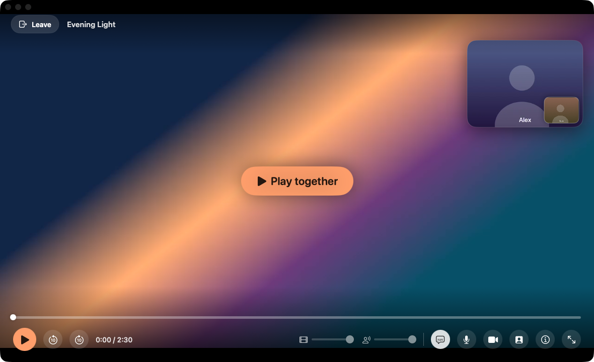

| | |
|---|---|
| 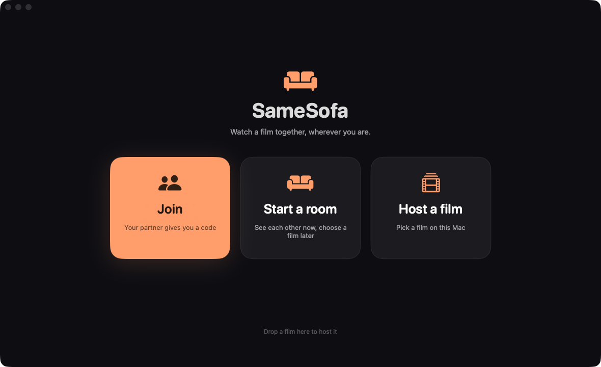 | 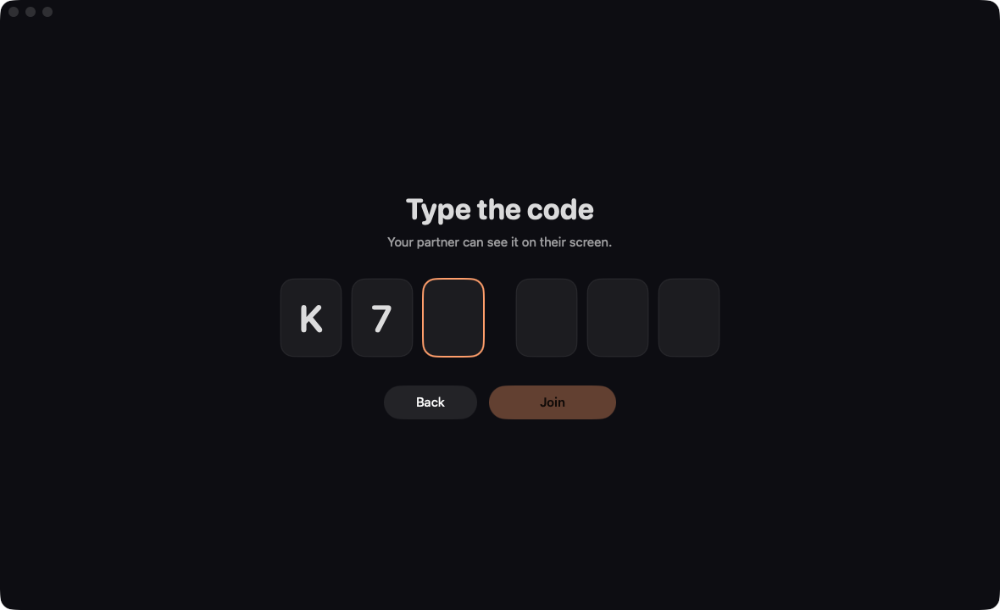 |
| 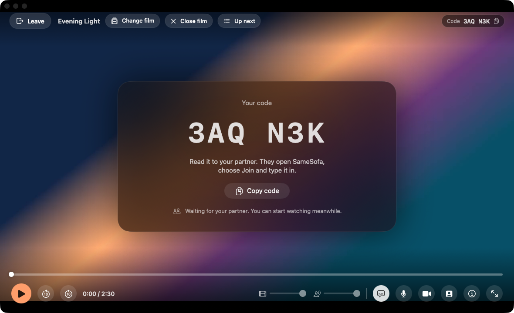 |  |

| | |
|---|---|
| 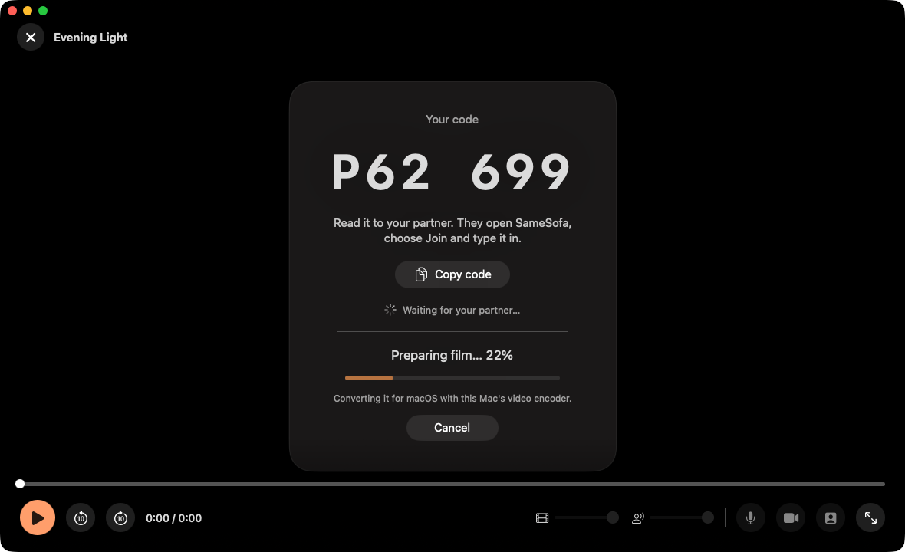 | 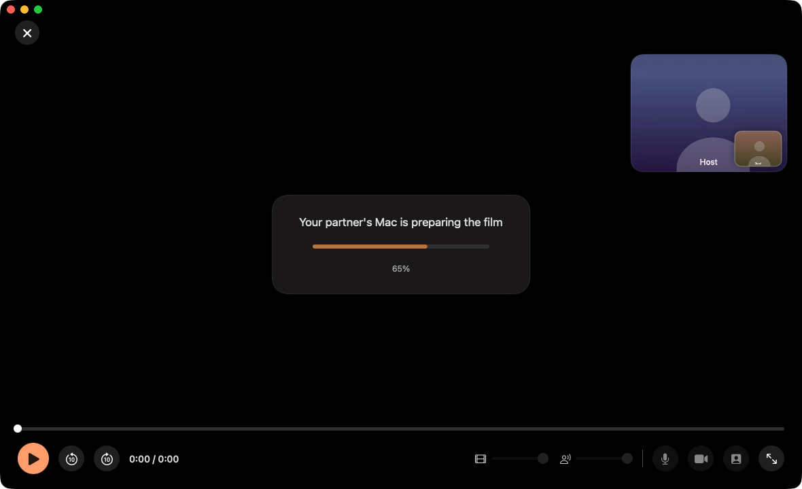 |

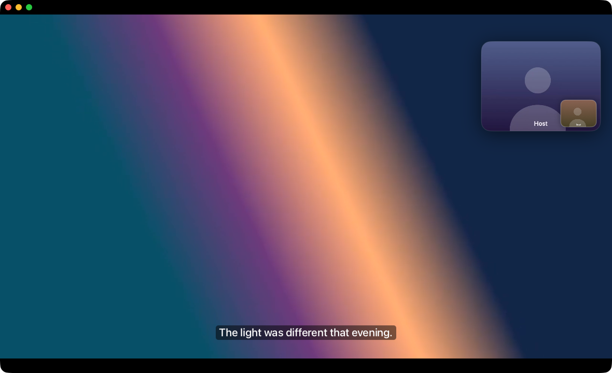

| | |
|---|---|
| 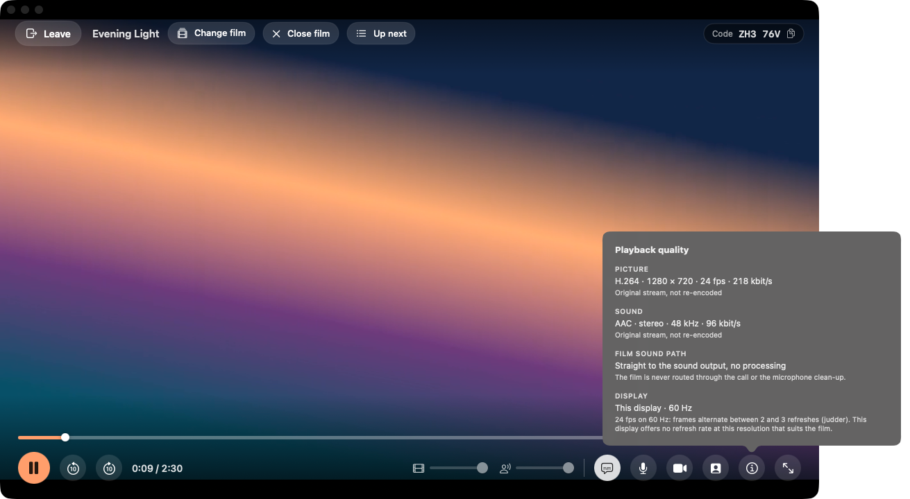 | 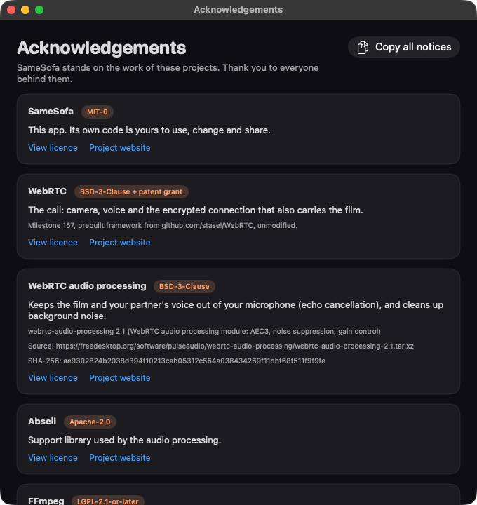 |
| 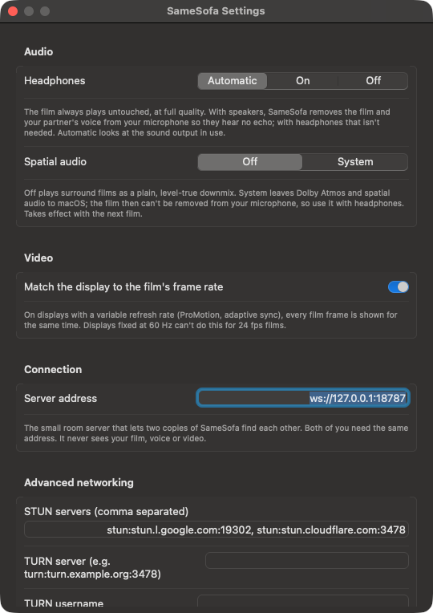 | 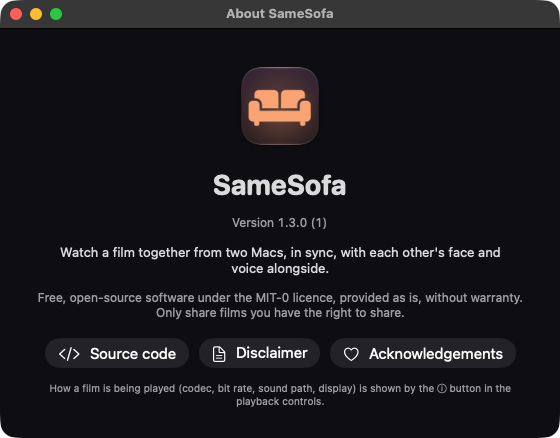 |

*(Screenshots use a generated test film and a generated stand-in camera
picture.)*

---

## Install (for the person who just wants to watch)

1. Open the **SameSofa .dmg** (or .zip) you were sent and drag **SameSofa** into
   **Applications**.
2. Open SameSofa from Applications. The first time, macOS will say it can't
   check the app for malicious software, because SameSofa isn't sold through
   Apple. That's expected:
   - Click **Done** (or **OK**) on that message.
   - Open **System Settings → Privacy & Security**, scroll down, and next to
     *"SameSofa was blocked…"* click **Open Anyway**. Enter your Mac password
     if asked, then click **Open Anyway** once more.
   - On macOS 14 you can instead right-click (or Control-click) SameSofa in
     Applications, choose **Open**, then **Open**.

   You only have to do this once. (For the technical one of you: running
   `xattr -dr com.apple.quarantine /Applications/SameSofa.app` in Terminal
   does the same thing.)
3. When SameSofa asks to use the **camera** and **microphone**, click **Allow**,
   so your partner can see and hear you. (If you clicked *Don't Allow* by
   mistake: System Settings → Privacy & Security → Camera / Microphone → turn
   SameSofa on, then quit and reopen SameSofa.)

### Watching

- **If you're joining:** click **Join** and type the code your partner reads to
  you. That's it. The film appears and starts as soon as enough of it has
  arrived.
- **If you're hosting:** click **Host**, pick the film (or drop it on the
  window), and read the code on screen to your partner.
- Either of you can press **Play together**, pause, or skip. Move the mouse to
  bring the controls back. Double-click the film (or press **F**) for full
  screen. **Space** plays/pauses, **←/→** skip 10 seconds, **M** mutes you.
- Speakers and headphones both work and both play the film untouched.
  *Settings → Audio → Headphones* is on **Automatic**; set it by hand if
  SameSofa guesses your sound output wrong. The **ⓘ** button in the controls
  shows what is being played and how.

---

## What files work

The host picks (or drops) a film; the guest needs nothing but the app.

- **MP4, M4V, MOV** that macOS plays are shared byte for byte, as before.
- **MKV, WebM, AVI, MPEG-TS (`.ts`, `.m2ts`), FLV, WMV/ASF, MPEG-PS (`.mpg`,
  `.vob`), Ogg, 3GP, RealMedia** and MP4/MOV files macOS can't play are first
  turned into an MP4 on the host's Mac ("Preparing film… 43%"). The room and
  its code are there straight away; your partner can join while it runs.

Each stream is handled on its own:

| Rewrapped (copied, seconds, no quality change) | Converted (re-encoded on the host) |
|---|---|
| Video: H.264 (8-bit 4:2:0), HEVC/H.265 Main and Main 10 | Video: MPEG-4 ASP (Xvid, DivX), VP8, VP9, AV1, MPEG-2, MPEG-1, VC-1/WMV, H.263, Theora, MJPEG, H.264 High 10/4:2:2/4:4:4, and anything else FFmpeg reads → H.264, or HEVC for 10-bit/HDR and above 1080p, with the Mac's VideoToolbox encoder at the same size and frame rate, at bit rates chosen to be visually transparent (1080p: 10 Mbit/s H.264, 7.5 Mbit/s HEVC; 4K HEVC: 21 Mbit/s and up; more for 60 fps, 10-bit and HDR; never less than the source used). 10-bit, colour tags and HDR10 metadata are kept |
| Audio: AAC, AC-3, E-AC-3 (Dolby Digital/Plus), ALAC, FLAC | Audio: MP3, DTS, Opus, Vorbis, MP2, WMA, … → AAC-LC from Apple's encoder (stereo 256 kbit/s, 5.1 448 kbit/s; 7.1 is mixed to 5.1 at 640 kbit/s). Lossless stereo (PCM, TrueHD, DTS-HD MA) → Apple Lossless; lossless surround → AAC at the rates above. Levels are never changed |
| Subtitles: the first text track (SRT, ASS/SSA, WebVTT) or a same-named `.srt`, as an MP4 text track | |

Measured on a 2020 Mac mini (M1, 16 GB) with 10-minute 1080p24 test films:

| Film | Path | Time | Speed |
|---|---|---|---|
| MKV, H.264 8 Mbit/s + AAC (607 MB) | rewrap | 1.3 s | 456× real time |
| AVI, Xvid 1080p + MP3 (1.06 GB) | convert video and audio | 70 s | 8.5× real time |
| WebM, VP9 + Opus (330 MB) | convert video and audio | 71 s | 8.5× real time |

Both conversions are limited by the hardware H.264 encoder (about 200 frames
a second at 1080p on an M1); the rewrap figure had the film in the disk cache
(from a cold SSD, expect a few seconds per GB). So a two-hour MKV that only
needs rewrapping is ready in well under a minute, and a two-hour 1080p film that needs converting takes
roughly 14 minutes on an M1 (faster on newer Macs, slower on Intel Macs
without a recent hardware encoder).

**Damaged timing.** Some MP4/MKV files carry video with B-frames but no
reordering information (every frame's presentation time equals its decode
time). FFmpeg-based players hide this; AVFoundation shows the frames in decode
order, which looks like the picture flickering back and forth. SameSofa
checks for it when you pick a film (it decodes three short stretches and
compares the decoder's picture order with the file's times) and repairs it by
copying the streams with rebuilt presentation times (FFmpeg's `dts2pts`, plus
exact times for the last few frames, which that filter cannot work out). The
result is checked again before sharing; if it doesn't hold up, the picture is
re-encoded instead and the app says so.

Only the default (or first) video and audio track are kept, to keep the
transfer small. What doesn't work: picture-based subtitles (Blu-ray PGS, DVD
VobSub), DRM-protected files, and files FFmpeg itself can't read. The host is
told straight away if a film can't be used.

---

## How it works

```
   Host Mac                                               Guest Mac
 ┌────────────────────────┐                        ┌────────────────────────┐
 │ AVPlayer (local file)  │  control channel: play/pause/seek, heartbeats,  │
 │ SyncEngine ◄───────────┼──── clock ping/pong, chunk requests ──────────►│ SyncEngine
 │ FileSender ────────────┼──── file channel: original bytes (64 KiB) ────►│ FileReceiver → sparse temp file
 │                        │                                                 │   → AVAssetResourceLoader → AVPlayer
 │ AudioHub (call audio,  │◄─── WebRTC audio + video (camera, mic) ───────►│ AudioHub
 │  AEC3 on the mic)      │        all peer to peer, DTLS/SRTP encrypted    │
 └──────────▲─────────────┘                                                 └──────────▲─────────────┘
            │  WebSocket: "create room" / "join ABC123" / relay offer, answer, ICE        │
            └──────────────────────► server/ (tiny Node room server) ◄──────────────────┘
```

### Getting the film to the guest: the original bytes, over a data channel

The host does **not** re-encode the film into a live video stream. It sends the
**original file** over a reliable, ordered WebRTC data channel, in 64 KiB chunks,
and the guest plays it from a local sparse file through
`AVAssetResourceLoaderDelegate` (a custom `samesofa-film://` URL). So:

- picture and sound are the original quality, and each Mac decodes locally,
  which is also what makes frame-accurate sync possible;
- the guest asks for chunks (a window of 64 in flight). Ranges the player is
  waiting for jump the queue on both sides; next come the last chunks of the
  file (MP4 files often keep their index at the end, so this makes them
  startable quickly), then everything from the playhead forwards, then the rest;
- the host never lets more than ~1 MB queue up inside WebRTC
  (`bufferedAmount` backpressure) so a seek redirects the transfer quickly;
- playback starts once about 8 seconds ahead are available. If the guest runs
  dry, **both** sides pause ("Waiting for your partner to catch up…") and the
  host restarts both together when the guest is ready again;
- the whole file keeps arriving in the background and is checked byte for byte
  in the integration test. The guest's copy lives in a temporary folder and is
  deleted when the session ends (and at the start of the next one, in case the
  app was force-quit).

Re-encoding into a WebRTC video track would have been simpler to start but
loses quality, costs CPU on the host for the whole film, and makes the call and
the film fight over one congestion controller. It was not needed.

### Films macOS can't play: converted on the host, then shared

AVPlayer only understands MP4/MOV with a handful of codecs. Rather than
replacing the player, SameSofa makes the film fit it, on the host's Mac,
before sharing:

1. **Look.** The host's Mac asks AVFoundation whether it can play the file and
   runs the bundled `ffprobe` on it. A playable MP4/MOV is shared untouched.
2. **Decide, stream by stream** (`MediaPlanner` in `SameSofaCore`, unit
   tested): copy every stream AVPlayer can decode from an MP4 and re-encode only
   the rest (tables above). The default video and audio tracks are picked,
   cover art is skipped, HEVC is labelled `hvc1` (what AVFoundation wants), AVI
   timestamps are regenerated, interlaced video is deinterlaced when it has to
   be re-encoded anyway, 10-bit/HDR stays 10-bit (HEVC Main 10).
3. **Convert** with the bundled `ffmpeg` into a temporary MP4. Video is encoded
   by the Mac's own VideoToolbox (hardware) encoder at the source's size and
   frame rate with a keyframe every 2 seconds (so seeks stay quick for the sync
   engine), audio by Apple's AAC encoder (through FFmpeg's `aac_at`) or as
   Apple Lossless. The app shows real progress (from
   `ffmpeg -progress`) and a Cancel button; the room is already open and the
   guest sees "Your partner's Mac is preparing the film… 43%".
4. **Share** the MP4 exactly like any other MP4: same transfer, same sync,
   same sound path. The temporary file is deleted when the
   session ends or the app quits, and leftovers from a crash at the next launch.

Why this way round: the transfer, the sync engine and the echo cancellation
(which listens to the film's sound inside AVPlayer) all build on AVPlayer.
Playing MKV directly with VLCKit or libmpv on both Macs would have meant a
second sync implementation (their clocks, seeking and rate control behave
differently), a second way to get at the film's audio, a much larger LGPL/GPL
dependency on both sides, and the guest would need it too. Converting on the host keeps the guest's side
unchanged and costs seconds for the common case (MKV with H.264/HEVC + AAC/AC-3
just gets rewrapped). The price is a wait before sharing when a film has to be
re-encoded, and some loss of quality in that case (generous bit rates keep it
small).

Converting while already sharing (fragmented MP4, guest starting before the
host is done) was left out: the guest's transfer is built around a file whose
size is known up front and whose index can be fetched first, and a rewrap is
fast enough that it doesn't matter. For re-encodes it would be the next step.

FFmpeg runs as separate helper programs (`Contents/Helpers/ffmpeg`,
`ffprobe`) with their own LGPL shared libraries, built by
`scripts/build-ffmpeg.sh`; nothing from FFmpeg is linked into SameSofa itself.
See *Third-party software* below.

### Staying in sync

Both apps run the same `SyncEngine` (in `Sources/SameSofaCore`, unit tested):

- A **shared timeline** says "the film is at position *p* at shared time *t*,
  playing or paused". Any button press on either side creates a new timeline
  with a higher sequence number; simultaneous presses resolve the same way on
  both sides (higher sequence wins, host breaks ties).
- The guest measures the **clock offset** to the host NTP-style (ping/pong on the
  control channel, minimum-round-trip sample wins).
- Play is scheduled ~0.35 s in the future and started with
  `AVPlayer.setRate(_:time:atHostTime:)` so both start on the same instant.
- Every half second the guest compares its player with the timeline: gaps under
  60 ms are ignored; up to 0.35 s its playback speed is nudged by 0.2 to 1 %
  (plain resampling, at most a sixth of a semitone, so it cannot be heard)
  until the gap is closed; beyond that it seeks.
- The host never changes speed. If its own player slips, the timeline moves to
  where the player is and the guest follows. While nothing drifts, both players
  run at exactly normal speed.
- The host sends a heartbeat every second so a missed message is healed.

### The film's sound, and echo cancellation

**The film** is played by AVPlayer straight to the Mac's sound output: no
audio engine of SameSofa's, no Apple voice processing, no resampling or level
change in between, whether or not a call is running. Its audio is set up once
per film and never touched again (spatial audio is switched off by default so
that surround and Dolby Atmos tracks are decoded to a plain multichannel
signal, which macOS folds down for stereo outputs: left and right at full
level, centre and surrounds at -3 dB, no LFE; *Settings → Audio → Spatial
audio: System* hands this back to macOS). Earlier versions pulled the film's
sound out of the player and replayed it through the call's audio engine,
which is where its quality problems came from.

**The echo problem:** both Macs play the film out loud. The guest's microphone
hears the guest's film and the host's voice, and without care the host would
hear their own voice and a second, delayed copy of the film. An echo canceller
can only remove what it has as a **reference**. WebRTC's own canceller only
knows the voice it plays; the film, played by AVPlayer, is invisible to it.

So SameSofa runs its own instance of the same canceller and tells it
everything the speakers play:

- `AudioHub` is a custom WebRTC audio device (WebRTC's `RTCAudioDevice`
  protocol; the macOS framework implements it but doesn't ship the header, so
  it is re-declared in `Sources/CWebRTCAudioDevice`). It plays the other
  person's voice and records the microphone through a plain `AVAudioEngine`,
  only while a call is running.
- Each 10 ms of microphone audio goes through WebRTC's audio processing module
  (AEC3 echo canceller, noise suppression, gain control; the stand-alone
  `webrtc-audio-processing` build, linked statically) before WebRTC gets it.
  WebRTC's built-in processing is switched off.
- The canceller's reference is the voice being played plus a **copy** of the
  film's sound: an `MTAudioProcessingTap` listens inside AVPlayer without
  changing anything (measured bit-exact, see Tests), the copy is folded down
  to stereo and lined up with the film's clock, so that the reference is what
  the speakers are playing at that moment, through pauses, seeks and sync
  nudges. AEC3 finds the remaining delay (speaker and room) itself.
- With **headphones** (built-in jack, AirPods and other Bluetooth headphones,
  USB headsets: recognised from the sound output's type) the microphone does
  not hear the film, the film is left out of the reference and no tap is
  attached at all. *Settings → Audio → Headphones* overrides the detection.
- If AirPods are both output and microphone, macOS switches them to telephone
  quality; SameSofa then records from the Mac's built-in microphone instead,
  so the film keeps its full quality.

Limits, honestly:

- The build machine has **no microphone**. The canceller was measured in an
  offline simulation (film through a synthetic room into the "microphone",
  plus a person talking: see Tests), not with real speakers and a real
  microphone. Expect it to behave like a browser video call that has music
  playing on the same computer.
- Loud film sound through laptop speakers while you talk is the hardest case:
  the canceller then also takes a little off your voice. Headphones avoid it.
- A film's echo that the canceller cannot model (very reverberant rooms,
  speakers far from the microphone, a Bluetooth speaker with a long delay)
  comes through faintly.
- Real Dolby Atmos content could not be tested (FFmpeg cannot create it).

### The room server

`server/` is ~150 lines of Node with one dependency (`ws`). It:

- creates a room with a random 6-character code (no `0/O/1/I/L`, so codes
  survive being read out), lets exactly one guest join, and relays WebRTC
  offers, answers and ICE candidates between the two;
- never sees audio, video or the film; keeps rooms only in memory; rooms expire
  after 12 hours; a guest can rejoin a room if they drop;
- closes a connection after 10 wrong codes, caps message size at 64 KB;
- logs only "room created/joined" lines with a timestamp (no codes, no IPs).

Once the two Macs are connected, the room server is no longer needed for that
session.

---

## Privacy

- Camera, microphone and the film go **directly between the two Macs** over
  WebRTC, encrypted with DTLS-SRTP (media) and DTLS (data channels). There is no
  SameSofa cloud.
- The **room server** you run sees: the room code, the two IP addresses that
  connect to it, and the WebRTC connection descriptions it relays (which include
  your network addresses). It keeps none of this beyond the open room in memory.
- **STUN** servers (by default Google's and Cloudflare's public ones) see your
  public IP address so your Mac can learn it. If you configure a **TURN** relay,
  that relay carries your encrypted traffic but cannot decrypt it.
- No accounts, no analytics, no crash reporting, nothing written anywhere except
  the guest's temporary copy of the film (deleted after the session) and your
  settings in the app's preferences.

---

## Run the room server

Both apps must use the same server, reachable over `wss://` (TLS) from the
internet. The server listens on plain HTTP/WebSocket; put it behind any
TLS-terminating reverse proxy.

**Docker**

```sh
cd server
docker build -t samesofa-signalling .
docker run -d --name samesofa --restart unless-stopped -p 127.0.0.1:8787:8787 samesofa-signalling
```

**systemd** (no Docker): see `server/samesofa-signalling.service` for a hardened
example unit; it expects the folder at `/opt/samesofa-signalling` and Node 18+.

**Reverse proxy**, e.g. Caddy (handles certificates and WebSockets automatically):

```
sofa.example.org {
    reverse_proxy 127.0.0.1:8787
}
```

nginx needs the usual WebSocket upgrade headers (`proxy_http_version 1.1;
proxy_set_header Upgrade $http_upgrade; proxy_set_header Connection "upgrade";`)
and a `proxy_read_timeout` above the server's 25-second ping interval.

Check it: `curl https://sofa.example.org/` should print `samesofa signalling ok`.

Environment variables: `PORT` (default 8787), `HOST` (default `127.0.0.1`; the
Docker image uses `0.0.0.0`).

### Point the app at it

Either:

- **Bake it in** (best for the non-technical side; nothing to type):
  `SAMESOFA_SERVER_URL=wss://sofa.example.org scripts/build.sh`, then send that
  build; or
- **Settings**: SameSofa ▸ Settings… ▸ *Server address*, on both Macs. Settings
  survive app updates.

Builds without a server show a friendly "this copy doesn't know its server yet"
message instead of trying `wss://CHANGE-ME.example`.

### When you need TURN

Most home connections work with STUN alone. Some networks (symmetric NAT,
carrier-grade NAT on mobile, strict office/hotel/university Wi-Fi) need a TURN
relay: run e.g. [coturn](https://github.com/coturn/coturn) and enter its
`turn:` / `turns:` URL, username and password under *Settings ▸ Advanced
networking* on both Macs.

A relay can also be baked in, like the server address:
`SAMESOFA_TURN_URL=turn:turn.example.org:3478 SAMESOFA_TURN_USERNAME=…
SAMESOFA_TURN_CREDENTIAL=… scripts/build.sh`. It is used while the TURN field
in Settings is empty; a relay entered there takes its place. Whatever is baked
in can be read out of the app by anyone who has that copy, so use a relay
account made for the purpose. The build script never prints these values.

*Settings ▸ Connection ▸ Test connection* checks the room server and, if a
relay is set (or baked in), that the relay hands out an allocation with those
credentials. One line each, with what to do when it fails.

---

## Build from source

Requirements: macOS 14+, Xcode 16 or newer (Swift 5.10+). Node 18+ for the
server.

```sh
scripts/build.sh            # universal (Apple silicon + Intel) app, .zip and .dmg in dist/
SAMESOFA_ARCHS=arm64 scripts/build.sh                     # faster, Apple silicon only
SAMESOFA_SERVER_URL=wss://sofa.example.org scripts/build.sh   # bake in your server
```

`scripts/build.sh` downloads WebRTC (checksum verified) into `Vendor/`, builds
the echo canceller library and the FFmpeg helper (below), builds with SwiftPM, assembles `build/SameSofa.app`
(Info.plist with camera and microphone usage strings, WebRTC.framework and the
FFmpeg helper embedded) and signs it:

- with `SAMESOFA_SIGN_IDENTITY="Developer ID Application: …"` it signs with the
  hardened runtime and `Resources/SameSofa.entitlements` (camera, audio input).
  It does not notarize; do that yourself with `xcrun notarytool` if you have an
  Apple Developer account, which removes the "Open Anyway" step;
- otherwise it **ad-hoc** signs (fine for personal use, needs the Gatekeeper
  step above).

**The echo canceller.** `scripts/build-apm.sh` (run by `build.sh`; run it
once yourself before `swift build` or `swift test`) downloads
webrtc-audio-processing 2.1 (pinned, SHA-256 checked; its Abseil dependency
comes from the pinned meson wrap inside), and builds it for arm64 and x86_64
into `Vendor/APM` as one static library (about a minute, once). It needs
`brew install meson ninja`.

**The FFmpeg helper.** `scripts/build-ffmpeg.sh` (run by `build.sh`) downloads
FFmpeg 8.1.3 and dav1d 1.5.4 (pinned, SHA-256 checked), and builds them for
arm64 and x86_64 into `Vendor/FFmpeg` (a few minutes, once; it is rebuilt only
when the script changes). It needs `brew install nasm meson ninja pkg-config`.
The configuration is LGPL only (no `--enable-gpl`/`--enable-nonfree`, no
x264/x265) and the script fails if that ever changes. `SAMESOFA_NO_FFMPEG=1
scripts/build.sh` leaves the helper out; that build can only host MP4/MOV.

### Tests

```sh
scripts/build-apm.sh                # once: the echo canceller library the package links
swift test                          # sync engine, conversion planner, timestamp repair logic, sound routing
(cd server && npm ci && npm test)   # room server
```

End-to-end test: two complete peers (host and guest) in one process, real
WebRTC, real AVPlayers, a real room server over loopback, synthetic camera and
microphone, no sound played:

```sh
(cd server && PORT=18787 node server.js &)
ffmpeg -f lavfi -i testsrc2=s=1280x720:r=24:d=180 -f lavfi -i sine=f=330:d=180 \
       -c:v libx264 -b:v 1500k -pix_fmt yuv420p -c:a aac test.mp4     # moov at the end
swift build --product samesofa-itest
.build/debug/samesofa-itest --server ws://127.0.0.1:18787 --film test.mp4 --soak 120
.build/debug/samesofa-itest --server ws://127.0.0.1:18787 --film test.mp4 --soak 90 --throttle 150000
```

It checks: room by code (typed in lower case with a dash), video and audio both
ways, guest playback without having the file, clock-offset discovery (the guest
pretends its clock is 1234.567 s off), play/pause/seek from both sides, recovery
from a forced drift (0.2 s closed by a speed change of at most 1 %, 0.7 s and
4 s by seeking), drift under 0.25 s for the soak period, that the host never
changes speed, that each film's sound is set up exactly once, that muting,
the headphones setting, the volume and a change of sound devices leave the
film untouched (same speed, no break in its sound, no shift against the
timeline), the received file being byte-identical (SHA-256), and
leaving/rejoining. `--live-audio 1` runs the host with the real call audio
engine (silent) instead of the synthetic one. The
`--throttle` run caps the host's upload below the film's bitrate and checks that
both sides pause when the guest runs dry and resume together.

Conversion end-to-end test: generate the synthetic test films (each has a
white flash and a beep at 1, 4, 7, … s), then run every one through the host's
conversion, the transfer and synced playback:

```sh
scripts/dev/make-test-films.sh /tmp/films        # needs a full ffmpeg (e.g. Homebrew's) to *make* the films
T=/tmp/films
.build/debug/samesofa-itest --server ws://127.0.0.1:18787 --reference-ffmpeg "$(which ffmpeg)" \
  --convert-suite $T/h264-aac.mkv,$T/hevc10-ac3.mkv,$T/vp9-opus.mkv,$T/av1-opus.webm,$T/xvid-mp3.avi,$T/h264-mp3.avi,$T/two-audio-srt.mkv
.build/debug/samesofa-itest --convert-bench film1.mkv,film2.avi   # conversion speed only
```

For each film it checks the remux/transcode decision, that the code is shown
while the film is still being prepared, play/pause/seek from both sides with
drift under 0.25 s, that the film's sound reaches both audio engines, that the
guest's copy is byte-identical to the converted film, subtitles (on both sides,
toggling), and, decoding the guest's copy with AVFoundation, that every flash
and beep is where FFmpeg puts it in the source (within 5 ms for the picture and
12 ms for sound; AVI within a frame, see below) and that audio/video sync is
unchanged. It also cancels a running conversion and checks the partial file is
removed.

`.github/workflows/ci.yml` runs the server tests, the unit tests, the FFmpeg
helper build (cached, with an LGPL-only check) and an Apple-silicon app build
on GitHub's macOS runners. It is manual-only at the moment because GitHub
Actions isn't available for the account; the comment in the file shows how to
switch it back to running on every push.

Damaged timestamps: builds H.264 and HEVC clips with B-frames whose picture
carries the frame number, strips their presentation times (`pts = dts`), and
checks detection, the repair (every frame back at its original time, read
back from the picture as AVFoundation presents it; sound unmoved), the
fallback to re-encoding, and that healthy films raise no alarm:

```sh
.build/debug/samesofa-itest --timestamp-suite /tmp/ts --reference-ffmpeg "$(which ffmpeg)" --healthy film1.mkv,film2.mp4
```

The film's sound path, without playing a sound: plays each file with a real
AVPlayer (muted), compares what the player goes on to play with the decoded
source (it must be bit-exact, with no dropped or repeated samples, the film's
clock steady and the sound set up once), renders the same tap offline through
AVFoundation's stereo fold-down, and shows what SameSofa 1.1.0 did to the
same channels. The last step, the Mac's sound output itself, cannot be
captured without a loopback device:

```sh
.build/debug/samesofa-itest --audio-measure a.m4a,b.mp4 --seconds 60 --reference-ffmpeg "$(which ffmpeg)"
```

The echo canceller, simulated offline (film through a synthetic room into the
microphone, plus a talker; reports how much of the film is removed and how
much of the talker survives):

```sh
.build/debug/samesofa-itest --echo-sim film.wav,talker.wav     # 48 kHz stereo film, 48 kHz talker
```

`.build/debug/samesofa-itest --audio-check 1` starts the real call audio
engine at zero volume and reports whether it runs on that Mac, the sound
output it found and whether it counts as headphones.

### Layout

```
Sources/SameSofaCore      protocol messages, sync engine, clock sync, chunk map/scheduler, film conversion planner, timestamp checks, sound routing (pure Swift, unit tested)
Sources/SameSofaKit       WebRTC call, data channels, file sender/receiver, playback controller, audio engine, FFmpeg helper runner
Sources/SameSofa          the SwiftUI app
Sources/samesofa-itest    end-to-end test runner
Sources/CWebRTCAudioDevice, CAudioTap, CEchoCanceller   small C/Objective-C/C++ headers and shims
server/                   room server (Node + ws), tests, Dockerfile, systemd unit
scripts/                  build.sh, fetch-webrtc.sh, build-apm.sh, build-ffmpeg.sh, make-icon.swift; dev/ test-film and screenshot helpers
```

---

## Known limits and what hasn't been tested

- Tested on one Mac over loopback only: real NAT traversal between two homes in
  different countries, slow or lossy uplinks, and long (2-hour, multi-GB) films
  have not been exercised end to end. The throttled test simulates a slow
  uplink; real networks will add jitter.
- Echo cancellation with real speakers and microphones is untested (simulated
  only, see above), as are headphone detection on real devices and the switch
  to the built-in microphone with Bluetooth headphones.
- Frame-rate matching is a request to the display: on variable-refresh displays
  (ProMotion, adaptive sync) macOS can follow it, on a display fixed at 60 Hz a
  24 fps film still alternates between two and three refreshes per frame. The
  build machine's display is fixed at 60 Hz, so the effect on a ProMotion
  display is untested. SameSofa does not switch display modes.
- Real Dolby Atmos (E-AC-3 JOC) content was not available for testing.
- The timestamp repair handles the plain form of the defect (presentation time
  equal to decode time); other kinds of damaged timing fall back to
  re-encoding the picture.
- The real camera path (`RTCCameraVideoCapturer`) is untested here (no camera on
  the build machine); tests and screenshots use a synthetic camera.
- The film transfer and the video call share the host's upload. On a slow
  uplink the call video is capped at 700 kbit/s, but a large file transfer can
  still make the call choppier until the guest has enough buffered.
- If the connection between the two drops (Wi-Fi change, sleep), the host goes
  back to "waiting" with the same code and the guest has to rejoin; the guest
  re-downloads the film into a new temporary file.
- The guest needs free disk space roughly the size of the film.
- One film per session; to switch films, leave and host again.
- Converting (not just rewrapping) a film takes minutes and the guest can't
  start before it's done. Re-encoded video loses a little quality.
- Only one audio track and one subtitle track are carried; picture-based
  subtitles (PGS, VobSub) are dropped. Subtitles are on/off per person.
- AVI can't store presentation times. With B-frames, players disagree by up to
  a frame about where the picture belongs; SameSofa's result was within one
  frame (≈ 40 ms) of FFmpeg's reading in the tests, and closer to the true
  timing than FFmpeg's own playback of the test AVIs.
- The conversion was tested on Apple silicon (M1) only. The x86_64 half of the
  FFmpeg helper is built but hasn't been run on an Intel Mac.
- Real-world MKV/AVI files (odd muxers, broken indexes, variable frame rate,
  very long films) were not available; the tests use generated films.

---

## Third-party software

| Component | Licence | Used for |
|---|---|---|
| [WebRTC](https://webrtc.org) M157, prebuilt by [stasel/WebRTC](https://github.com/stasel/WebRTC) | BSD-3-Clause (+ WebRTC patent grant) | calls, data channels (embedded `WebRTC.framework`) |
| `RTCAudioDevice.h` copied from WebRTC | BSD-3-Clause | custom audio device protocol |
| [webrtc-audio-processing](https://www.freedesktop.org/software/pulseaudio/webrtc-audio-processing/) 2.1 | BSD-3-Clause | echo cancellation, noise suppression, gain control for the microphone (linked statically) |
| [Abseil](https://abseil.io) | Apache-2.0 | support library of the audio processing (linked statically) |
| [FFmpeg](https://ffmpeg.org) 8.1.3 | LGPL-2.1-or-later | converting and repairing films on the host (separate helper programs) |
| [dav1d](https://code.videolan.org/videolan/dav1d) 1.5.4 | BSD-2-Clause | AV1 decoding, inside the FFmpeg helper |
| [ws](https://github.com/websockets/ws) | MIT | room server WebSocket |
| Apple SF Symbols | Apple's terms, via the system | icons in the app |

The full notices are in [THIRD-PARTY-NOTICES.md](THIRD-PARTY-NOTICES.md), which
is also copied into the app (SameSofa ▸ Acknowledgements…).

**FFmpeg (LGPL-2.1-or-later).** The app bundles FFmpeg 8.1.3, unmodified, as
separate helper programs (`Contents/Helpers/ffmpeg`, `ffprobe`) and shared
libraries (`Contents/Frameworks/libav*.dylib`, `libsw*.dylib`); SameSofa runs
them as processes and links none of it. Built by `scripts/build-ffmpeg.sh` from
https://ffmpeg.org/releases/ffmpeg-8.1.3.tar.xz (SHA-256 checked) with
`--disable-gpl --disable-nonfree --disable-version3`, VideoToolbox/AudioToolbox,
dav1d (BSD-2-Clause) for AV1, and only the encoders, muxers and filters
SameSofa needs; the full flags are in THIRD-PARTY-NOTICES.md and in the app at
`Contents/Resources/FFmpeg/BUILDINFO.txt`, next to the LGPL text
(`COPYING.LGPLv2.1`). You can replace the helper with your own FFmpeg build
(same file names and places, then re-sign the app).

## Disclaimer

In short (details in [DISCLAIMER.md](DISCLAIMER.md)):

- SameSofa is provided as is, with no warranty and no support. Use it at your
  own risk.
- The project offers no hosted service; the placeholder server address is not a
  service. You run your own room server and are responsible for it.
- You are solely responsible for the films you share and for having the right
  to share them with the other person. SameSofa is for watching your own media
  with one other person; it does nothing to get around DRM and can't open
  DRM-protected files.
- Camera and microphone are used only for the call, peer to peer. Nothing is
  recorded or collected by the project.
- SameSofa isn't affiliated with or endorsed by any streaming or watch-party
  product or company; product names are trademarks of their owners.
- Security issues: report them privately via GitHub (Security tab ▸ Report a
  vulnerability) or open an issue; there is no guaranteed response time.

## Contributing

See [CONTRIBUTING.md](CONTRIBUTING.md). Contributions are accepted under MIT-0
(inbound = outbound).

## Licence

[MIT-0](LICENSE) (MIT No Attribution): use, copy, modify and redistribute
freely, no attribution required. Third-party parts keep their own licences (see
above).
